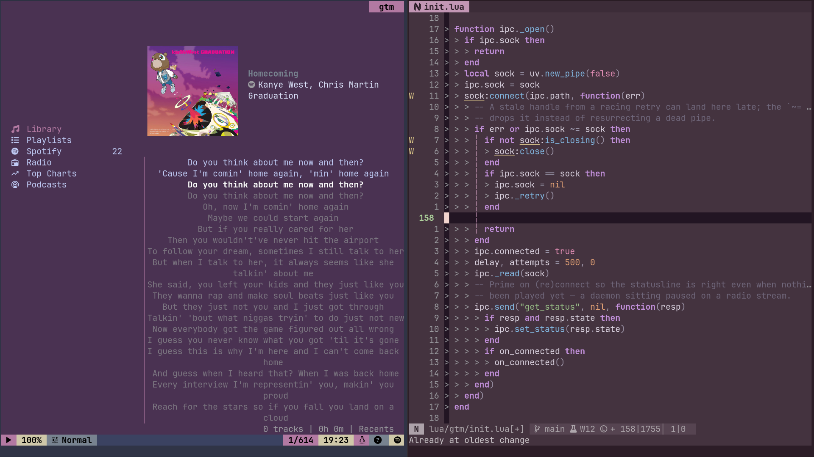

# gtm.nvim

[](https://www.gnu.org/licenses/gpl-3.0)
[](https://neovim.io)



`gtm.nvim` is a (thin) client for [gtm(d)](https://github.com/prjctimg/gtm) that
brings playback control, statusline integration and reactive theming inside
Neovim.

Small (~2kloc) and dependency free.

## Prerequisites

- [gtm](https://gtmd.dev)
- Nerd Font (optional, but recommended)

We only need the daemon binary (`gtmd`).

## Quick start

```lua
{ "prjctimg/gtm.nvim", 
    opts = {} 
}
```

You need `gtmd` running,just start playing via `gtm` and it will just work.

That's it.

## Configuration

```lua
{
  "prjctimg/gtm.nvim",
  opts = {
    keymaps = {
      play_pause = "<leader>gp",
      next = "<leader>gn",
      prev = "<leader>gN",
      volume_up = "<leader>g>",
      volume_down = "<leader>g<",
      stop = "<leader>gS",
      queue = "<leader>gq",
      spotify = "<leader>gs",
      radio = "<leader>gr",
      search = "<leader>g/",
    },{
    statusline = {
      source = true,    -- ♫ Spotify ◉ radio ☁ podcast ❋ chart ▤
      state = true,     -- ▶ ⏸ ⏹
      artist = true,
      title = true,
      album = false,
      progress = true,  -- ━━━─ 20 columns
      time = false,     -- [01:23/04:56]
      volume = false,   -- vol:80%
      repeat = false,   -- [R]
      shuffle = false,  -- [S]
    },
  }
  },
}
```

[See the gtm docs](https://gtmd.dev/nvim) for an exhaustive overview.

## Contributing

See [CONTRIBUTING.md](CONTRIBUTING.md)

## Contributors

<!-- CONTRIBUTORS -->
<p align="left">
  <a href="https://github.com/iseeheaven"></a> <a href="https://github.com/prjctimg"></a>
</p>
<!-- /CONTRIBUTORS -->

## License

Copyright (C) 2026, [prjctimg](https://prjctimg.me)

Released under the [GPL-3.0 license](LICENSE).
